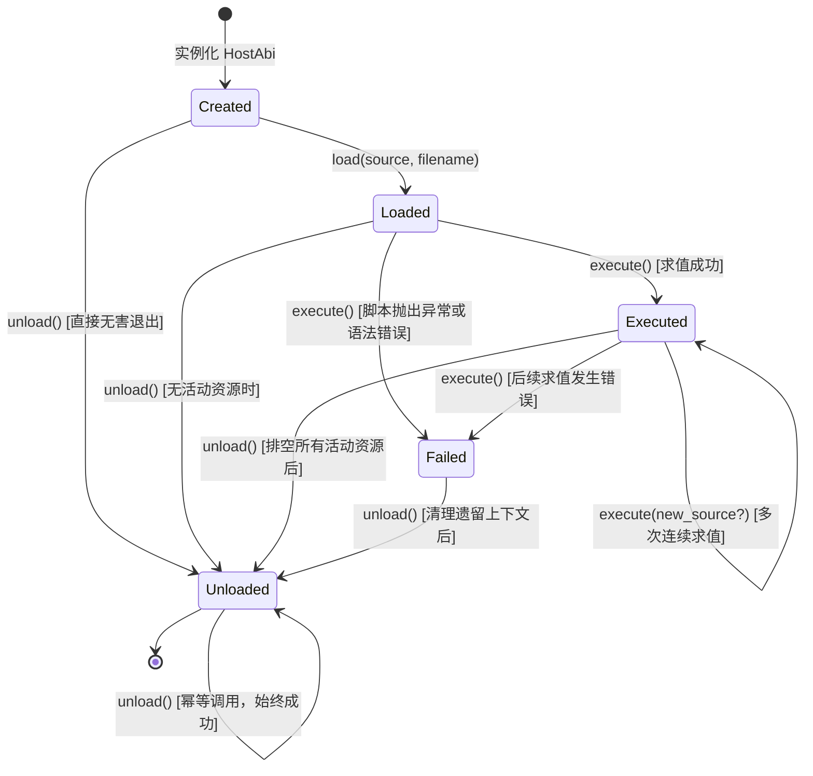

# Host ABI、内置变量与语言边界

## 1. 嵌入式 Host ABI 规范与架构设计

> **研究依据**：`rime-research/AutoHotkey-alpha`（`source/ahklib.idl`、`source/abi.h`、`source/abi.cpp`、`README-LIB.md`）。  
> **核心原则**：嵌入式宿主 ABI 必须提供严格版本化的生命周期契约（`load/execute/error/inspect/exit/unload`）。宿主与脚本环境通信严禁传递裸指针或裸 OS 句柄，统一使用不可变 JSON 快照与稳定订阅 ID；在宿主登记的任何活动资源未排空前，卸载必须被拒绝并给出逐项诊断；彻底排空后卸载必须保证确定性与零泄漏。

### 1.1 ABI 版本契约
- **当前版本**：`k_host_abi_version = 1`（定义于 `engine/js/include/rime/js/abi.hpp`）。
- **版本演进规则**：对 `load`、`execute`、`inspect`、`drain`、`exit`、`unload` 语义或状态机规则的任何不兼容变动，必须显式递增版本号，并在 Contract 测试中进行版本锁定断言。

### 1.2 宿主状态机（Host ABI State Machine）



- **`Created`（初建态）**：
  - 宿主完成 `QuickJS-ng` Context/Runtime 初始化与核心内置模块（`rime:runtime`）预装配。
  - 允许安装错误观察器（`set_error_handler`）与退出回调（`set_exit_handler`）。
  - 允许调用 `load(source, filename)` 进入 `Loaded` 态，或调用 `inspect()` 查询静态能力。
  - 允许直接调用 `unload()`，平稳进入 `Unloaded` 态。
  - **非法操作**：直接调用 `execute()` 拒绝并返回 `InvalidState`（"execute requires a loaded script but host is created"）。
- **`Loaded`（就绪态）**：
  - 脚本已通过 `load()` 暂存入宿主缓冲区，尚未求值。
  - 允许调用 `execute()` 进行初次求值。
  - 允许调用 `inspect()` 检查模块注册表与暂存脚本信息（不执行任何脚本代码）。
  - 允许在未启动任何异步或订阅前直接调用 `unload()` 返回 `Unloaded` 态。
  - **非法操作**：再次调用 `load()` 拒绝并返回 `InvalidState`（"load requires state created but host is loaded"）。
- **`Executed`（执行态）**：
  - 首轮脚本已求值完毕，Promise 微任务及初始事件排空完成。
  - 允许重复调用 `execute(new_source?, new_filename?)` 执行新脚本片段或模块。
  - 允许调用 `inspect()` 进行实时状态诊断。
  - 允许调用 `exit(code)` 触发退出流程并记录退出码。
  - 允许在排空所有活动资源后调用 `unload()`。
  - **非法操作**：再次调用 `load()` 拒绝并返回 `InvalidState`。
- **`Failed`（故障态）**：
  - 脚本执行过程中抛出未捕获的 JavaScript 异常或发生语法解析失败。
  - 触发 `on_error` 回调，传入故障源位置（`filename`/`where`）及错误摘要。
  - 宿主拒绝任何后续的 `execute()` 与 `load()`，保护崩溃现场不被后续代码二次污染。
  - 允许调用 `inspect()` 提取已记录的错误日志。
  - 允许调用 `unload()` 回收剩余资源并平稳进入 `Unloaded` 态。
- **`Unloaded`（卸载终态）**：
  - 宿主已完全停止并清理所有运行时资源。
  - `unload()` 在此状态下具有幂等性，重复调用直接返回 `Error::none()`。
  - **非法操作**：禁止调用 `load()` 或 `execute()`，均返回 `InvalidState`。

---

## 2. 核心 ABI 接口行为契约

| 方法签名 | 允许状态 | 状态转移 | 错误码与边界规则 |
|---|---|---|---|
| `int abi_version() const` | 任意状态 | 无 | 返回 `k_host_abi_version` (1) |
| `HostAbiState state() const` | 任意状态 | 无 | 返回当前状态枚举 |
| `Error load(source, filename)` | `Created` | `Created` → `Loaded` | 源为空返回 `InvalidContract`；非 `Created` 返回 `InvalidState` |
| `Error execute(source?, filename?)` | `Loaded`, `Executed` | `Loaded` → `Executed` / `Failed`<br>`Executed` → `Executed` / `Failed` | 自动通过 `JS_DetectModule` 识别 ES 模块与普通 Script；执行后自动 `drain()`；执行失败转移至 `Failed` 并触发 `on_error` |
| `std::string inspect(request_json)` | 任意状态 | 无 | 只读非求值诊断协议，输入空或 `{}` 默认返回全量快照；**绝对不执行未知代码** |
| `std::size_t drain()` | 任意状态 | 无 | 处理并投递排队的异步完成项（completions），排空 Promise 微任务队列，返回处理条目数 |
| `void exit(int code)` | 任意状态 | 无 | 记录退出码，以 `{"reason":"exit","code":N}` 触发 exit handlers，调用 `on_exit` 观察器。**注意：不是 unload，资源仍存活直至 unload()** |
| `int exit_code() const` | 任意状态 | 无 | 读取当前记录的退出码（默认为 0） |
| `Error unload()` | 任意状态 | `*` → `Unloaded` | 存在任何未排空的活动资源时拒绝并返回 `InvalidState` 及排查清单；排空后执行确定性清理并转移至 `Unloaded`；幂等 |
| `void set_error_handler(handler)` | 任意状态 | 无 | 注册全局错误处理钩子：`void(string_view where, string_view message)` |
| `void set_exit_handler(handler)` | 任意状态 | 无 | 注册全局退出处理钩子：`void(int code)` |
| `Host& host()` | 任意状态 | 无 | 宿主内部引擎访问逃生舱（同属 JS 线程亲和） |

---

## 3. 安全卸载（Unload Safety）与逐项诊断契约

为了彻底杜绝 Windows 自动化系统中最易发生的**句柄泄漏、悬垂回调与幽灵事件卡死**，Rime 的 `HostAbi::unload()` 执行严格的**活动资源前置检查（Pre-unload Busy Check）**。

### 3.1 八项活动资源排查清单（Itemized Diagnostic Reasons）

当 embedder 发起 `unload()` 请求时，宿主按以下 8 项独立计数器进行全面扫描。只要存在任何一项未归零，卸载即刻拒绝并返回 `InvalidState`，错误信息按统一格式拼接所有原因：

```text
unload refused while host is still active: [原因 1]; [原因 2]; ...
```

1. **活动订阅（Active Subscriptions）**：
   - 检查入口：`host_.subscriptions().list()`
   - 包含对象：全局按键热键（Hotkey）、热字串（Hotstring）、低级输入钩子（`InputHook`）、窗口事件监听、剪贴板变化观察者等。
   - 诊断文本：`N subscription(s): <id1>, <id2>; `
2. **驻留 JS 回调（Held JS Callbacks）**：
   - 检查入口：`host_.callback_count() > host_.exit_handler_count()`
   - 包含对象：通过 `runtime.subscribe` 或各原生服务注册并由 QuickJS 持有 `JSValue` 的回调闭包。
   - 诊断文本：`N JS callback(s) still held; `
   - *注：专门扣除待触发的 exit handlers，确保退出回调自身不会阻止卸载。*
3. **未决 Promise（Unresolved Promises）**：
   - 检查入口：`host_.pending_async() > 0`
   - 包含对象：通过 `runtime.delay` 挂起的延时、派发到 Worker 线程池的磁盘/网络操作、或等待 Win32 消息响应的未完成 Promise。
   - 诊断文本：`N unresolved promise(s); `
4. **武装计时器（Armed Timers）**：
   - 检查入口：`host_.timers().pending() > 0`
   - 包含对象：由宿主内部 `TimerService` 托管的武装中定时器。
   - 诊断文本：`N armed timer(s); `
5. **绑定中的异步路由（Bound Async Routes）**：
   - 检查入口：`host_.route_count() > 0`
   - 包含对象：中央 Action Kernel 调度中将 `ActionId` 与 Promise `token` 绑定的跨线程 RPC 路由。
   - 诊断文本：`N bound async route(s); `
6. **存活取消源（Live Cancellations）**：
   - 检查入口：`host_.cancellation_count() > 0`
   - 包含对象：通过 `runtime.cancellation()` 建立且未调用 `releaseCancellation()` 释放的 `CancellationSource`。
   - 诊断文本：`N live cancellation(s); `
7. **排队中的异步完成项（Queued Completions）**：
   - 检查入口：`host_.pending_completion_count() > 0`
   - 包含对象：Worker 线程或原生事件生产者已调用 `complete_async()` 完成计算、但主 JS 线程尚未调用 `drain()` 提取并兑现的 Promise 完成载荷。
   - 诊断文本：`N queued completion(s); `
8. **未投递的宿主事件（Pending Host Events）**：
   - 检查入口：`host_.event_queue() && !host_.event_queue()->empty()`
   - 包含对象：由低级钩子线程（`WH_KEYBOARD_LL`/`WH_MOUSE_LL`）或 Win32 消息泵异步推入 `HostEventQueue`、尚未在 JS 线程分发的事件包。
   - 诊断文本：`pending host event(s); `

### 3.2 资源排空与确定性卸载流程（Drain & Teardown Sequence）

当 embedder/测试将上述 8 类资源完全取消、注销或调用 `drain()` 排空后，`HostAbi::unload()` 执行严谨的时序化清理，保证零悬垂引用：

```text
[发起 unload()]
      ↓
[检查 8 项活动资源] ──(存在残留)──> [拒绝: 返回 InvalidState + 逐项排查清单]
      ↓ (全部归零)
1. 触发 Exit Handlers: 携带 {"reason":"unload","code":N} 执行并释放 JS 退出闭包
2. 关闭 SubscriptionRegistry: 清理所有订阅记录
3. 停止 TimerService: 停用计时线程
4. 执行 Native Teardowns: 移除原生钩子与 UI 观察者
5. 转移状态: state_ = HostAbiState::Unloaded
      ↓
[Host 析构阶段 (~Host)]
6. 关闭 HostEventQueue 管道
7. 停止 WorkerService: 等待后台工作线程优雅汇合 (Join)
8. 释放所有 JSValue 回调句柄
9. 放弃残余 Promise (以 "cancelled: shutdown" 格式化拒绝，防止悬挂)
10. JS_FreeContext(context_)
11. JS_RunGC(runtime_) 执行全量标记清除
12. JS_FreeRuntime(runtime_)
```

---

## 4. 线程亲和性与宿主分层边界（Lane Boundaries）

```text
       ┌─────────────────────────────────────────────────────────┐
       │             HostAbi Facade (JS Thread Affinity)         │
       │  load() / execute() / inspect() / drain() / unload()    │
       └────────────────────────────┬────────────────────────────┘
                                    │
                                    ▼
       ┌─────────────────────────────────────────────────────────┐
       │             rime::js::Host (QuickJS Context)            │
       │    Subscriptions, Timers, Promises, Callbacks, Routes   │
       └───────▲────────────────────▲────────────────────▲───────┘
               │                    │                    │
  Thread-safe  │ Push               │ Settle             │ Cancel
  Bridge:      │                    │                    │
       ┌───────┴───────┐    ┌───────┴───────┐    ┌───────┴───────┐
       │ HostEventQueue│    │complete_async │    │CancellationSrc│
       └───────▲───────┘    └───────▲───────┘    └───────▲───────┘
               │                    │                    │
═══════════════╪════════════════════╪════════════════════╪═══════════════ Lane Boundaries
               │                    │                    │
       ┌───────┴───────┐    ┌───────┴───────┐    ┌───────┴───────┐
       │    UI Lane    │    │  Worker Lane  │    │Automation MTA │
       │ (HWND, Hooks, │    │ (FS, Storage, │    │(IUIAutomation,│
       │  Direct2D)    │    │  Processes)   │    │ COM Patterns) │
       └───────────────┘    └───────────────┘    └───────────────┘
               │                    │                    │
               └────────────────────┼────────────────────┘
                                    ▼
               ┌─────────────────────────────────────────┐
               │  rime::win32::Bootstrap / DesktopHost   │
               │  OS Services Lifetime (start / stop)    │
               └─────────────────────────────────────────┘
```

1. **JS Thread 独占访问**：
   - `HostAbi` 与 `Host` 的成员方法（除明确声明的跨线程网桥外）必须且仅能在 JS 线程调用。
   - 禁止在其它线程直接操作 `JSContext*` 或 `JSRuntime*`。
2. **跨线程网桥安全**：
   - `HostEventQueue`：原生钩子与 Win32 消息向 JS 投递时，使用加锁的内存队列推入。宿主关闭时调用 `close()` 将后续推送变为无害 no-op。
   - `complete_async` / `reject_async`：后台 Worker 线程可在任意线程完成计算，载荷推入 `completions_` 并在 JS 线程唤醒循环中兑现。
   - `cancellation_token`：通过原子状态与加锁查找，实现跨线程安全传递取消信号。
3. **Host ABI 与 Bootstrap / DesktopHost 的职责正交划分**：
   - **Host ABI** 仅负责管理 QuickJS 脚本环境及其登记的活动实体（订阅、回调、计时器、Promise）。
   - **Win32 窗口过程与 COM 接口指针** 属于操作系统底层服务句柄，由 `rime::win32::Bootstrap`（及宿主封装 `rime::desktop::DesktopHost`）负责其物理生命周期。
   - 窗口消息泵与 HWND 随 `Bootstrap::stop()` 销毁，**不直接进入 Host ABI 的 unload 判定**；只有当脚本通过 `runtime.subscribe` 或事件模块为窗口登记了 JS 监听器时，才计入 Host ABI 的订阅/回调考量。

---

## 5. 可检查性接口规范（Inspect Protocol）

`HostAbi::inspect(request_json)` 遵循只读、安全、确定性原则。其目的是允许 CLI 工具、调试器或测试切片在不执行任何未知脚本的情况下，深度观察宿主内部状态。

### 5.1 请求格式
`request_json` 支持如下 `kind` 筛选（默认为 `"all"`）：
```json
{ "kind": "all" | "modules" | "functions" | "subscriptions" | "tasks" | "errors" }
```

### 5.2 响应字段规范
- **`modules`**：
  - `native`：已注册的原生 C++ 模块名称列表（如 `["rime:runtime", "rime:window", ...]`）。
  - `files`：已加载的外部 JavaScript 文件名列表。
  - `fileRoot`：限制模块加载的文件根路径。
- **`functions`**：全局对象上的顶层可枚举函数名称数组（只读枚举属性名，严禁隐式求值）。
- **`subscriptions`**：当前存活的订阅标签列表（如 `["hotkey#1", "js#2"]`）。
- **`tasks`**：
  - `async`：当前待 settle 的 Promise 计数。
  - `queued`：排队待兑现的完成载荷计数。
  - `timers`：武装中的计时器计数。
  - `worker`：Worker 线程池待处理任务计数。
  - `callbacks`：当前持有的 JS 回调总数。
- **`errors`**：宿主捕获的错误日志记录数组（每项包含 `where` 与 `message`）。
- **`persistent`**：脚本常驻状态标识（`persistent_force || live_declarative_probe`）。
- **`pendingTimers`**：尚未触发的延时定时器数目。
- **`pendingCompletions`**：排队待分发的完成包数目。

---

## 6. 内置变量

`A_*` 变量不是普通函数，不能遗漏。应按以下域建立 `builtins.json`：脚本路径/命令行、工作目录、时间/日期、窗口和控件、键鼠状态、循环/线程、用户和系统、临时目录、语言/编码、退出状态、托盘/脚本实例。每个变量要标记：动态读取还是快照、来源 API、更新时机、线程、权限和 TS 替代。

---

## 7. 语法与运行时

热键标签、热字符串、自动执行段、函数对象、异常/警告、伪线程、`Critical`、`Thread`、`OnError` 和消息泵顺序不能通过普通函数清单表达。Rime 不复制 AHK 的伪线程栈；用 JS task、Action parent、优先级、取消和 trace 表达同一类可观察行为，并记录无法兼容的细节。
